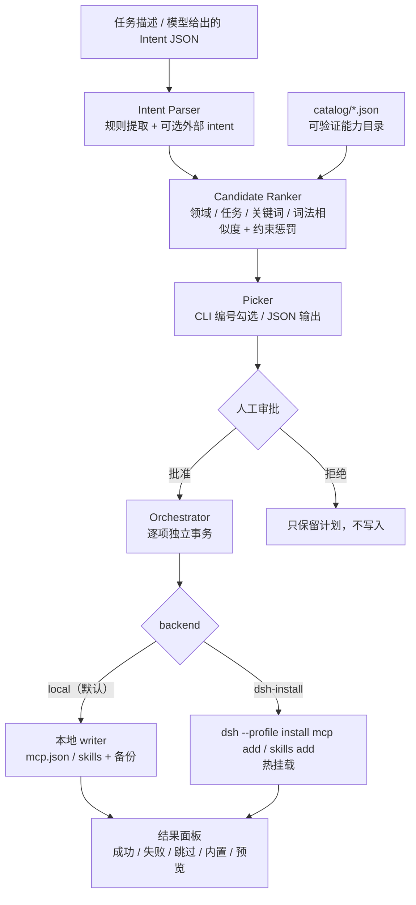

# dsh-forage

> **描述任务，挑能力，交给 DSH。**  
> Intent-aware capability router for DeepSeek Harness.

[](LICENSE)
[](package.json)
[](tests)
[](docs/roadmap.md)
[](https://github.com/lllyw666/dsh-forage/actions/workflows/ci.yml)

dsh-forage 不重复实现安装器。它补的是安装之前的决策层：

**任务意图 → 候选能力 → 人工勾选 → 本地原子写入，或委托 dsh-install 逐项部署。**

用户说一句“帮我检索这几篇论文并整理引用”，dsh-forage 提取任务、检索可安装的 MCP / Skill、展示风险与凭证要求、让用户勾选，默认用本地后端把选中项原子写入 `~/.dsh/mcp.json` / skills（写前备份），也可以显式加 `--backend dsh-install` 交给 @dsh-tools/dsh-install 热挂载。一个候选失败不会阻塞其余候选。

---

## 状态

v0.2.0 是可运行的 MVP + 交互/临时作用域/HTTP embedding 版本，不是概念稿。

- 已完成：规则意图解析、**discovery-first（MCP Registry + GitHub）**、catalog 离线兜底、混合排序、CLI 勾选、默认安全策略、人工审批、本地部署后端（原子写 + 备份）、发现快照、带 watcher 的 mcp-registry 插件、dsh-install 命令编排、`/forage` 命令、临时 session MCP 作用域、hashed + HTTP embedding、JSON 输出、失败隔离。
- 已验证：102 个项目测试（Windows 下 101 通过、1 个 POSIX 符号链接用例按平台跳过）+ 4 个插件 plan 测试 + 8 个 `/forage` 命令测试（`npm run test:plugin`），覆盖作用域迁移、本地 MCP/Skill 写入、环境 doctor、插件挂载、MCP Registry 发现、GitHub 发现与来源权重、MCP health check、staging/回滚、软件前置链接、`Other` 自由输入、端到端 CLI 流程与 Windows .cmd 启动器。
- 已在本机完成一次真实安装：DSH 0.2.1-rc.2 + dsh-install 0.1.1 安装 semantic-scholar，并通过 MCP health_check 调用；dsh-install 0.1.1 的 peer 范围与 DSH 0.2.1 不一致，安装时使用了 exact-version compatibility exemption。详见 [docs/verification.md](docs/verification.md)。
- 已提供：Web GUI/CLI 的只读 `/forage` 斜杠命令、`plan.selection` 原生多选载荷（配合 `ask_user_question` + Other）、MCP 的临时 session scope、HTTP embedding provider、MCP health check、staging/回滚、npm 打包与发布 workflow。仍缺：独立客户端页面、session Skill、真实 npm 发布、Registry 完整数据保证。

首次在真实环境使用，请先执行 dry-run，再确认安装。

---

## 为什么需要它

DSH 已经有安装器，但用户仍然需要自己回答三个问题：

1. **有什么可用？** MCP / Skill 分散在 npm、GitHub、marketplace 和不同客户端配置里。
2. **该装哪一个？** 缺少风险、权限、凭证、前置条件等统一元数据，选择成本高。
3. **装完怎么确认？** 安装后是否真的挂载、缺哪个环境变量、哪个候选失败，往往没有一张统一的结果面板。

dsh-forage 只做“装什么”的决策层。默认本地后端直接原子写 DSH 的注册表，项目自带的 watcher 插件负责挂载；需要 dsh-install 的卸载审计、Git/npm 源或安装编排时，显式加 `--backend dsh-install`。

---

## 与相邻项目的边界

| 项目 | 主要解决 | dsh-forage 的差异 |
|---|---|---|
| @dsh-tools/dsh-install | MCP / Skill 的注册表安装、热挂载、卸载、审计 | 不做“装什么”的排序与审批；dsh-forage 默认本地写，也可显式委托给它 |
| qvr / APM | Skill 的 lockfile、可复现安装、扫描 | 不做任务意图解析与交互勾选 |
| omni-skills | 统一运行时、目录 API、多客户端配置写入 | 不做从任务描述到候选排序的闭环 |
| mcp-skills-registry | 自托管注册中心，folder → MCP tool | 不做 DSH 原生安装前审批与工作区部署 |
| @khorsheed/dsh-capability-catalog | 枚举当前实例已有的 Skill / Tool，提供 list_capabilities | 枚举“已经有什么”，不是“可以装什么”；v0.2 用它做安装后核验 |
| **dsh-forage** | **意图解析 → 候选检索 → 交互勾选 → 本地写入 / 委托 dsh-install** | — |

核心判断：不要做通用 MCP 包管理器，也不要做又一个 Skill 注册中心。差异点是 DSH 原生的“任务 → 选择 → 审批 → 工作区部署”闭环。

---

## 30 秒快速开始

### 前置条件

- Node.js 20+
- DeepSeek Harness 0.2.x
- （可选）@dsh-tools/dsh-install：只有 `--backend dsh-install` 需要；默认本地后端不需要它

默认命令直接写注册表（安装一次项目自带 `plugin/` 后，watcher 会自动挂载；见“让 MCP 真正挂载”）：

    dsh-forage deploy --id semantic-scholar --scope user --yes

需要热挂载或 Git/npm 源 Skill 时：

    dsh plugin --profile install add @dsh-tools/dsh-install
    dsh-forage deploy --id semantic-scholar --scope user --yes --backend dsh-install

> **DSH 0.2.x 注意**：@dsh-tools/dsh-install 0.1.1 的 peer 版本声明是 0.1.x，最新发布也没有兼容 0.2.x 的版本。DSH 0.2.x 会跳过它；强行 `--accept-risk` 豁免可能崩溃或损坏数据。默认本地后端正是为了绕开这个依赖；`--backend dsh-install` 只在确认兼容时使用。

### 从源码运行

    git clone https://github.com/lllyw666/dsh-forage.git dsh-forage
    cd dsh-forage
    npm install
    npm run build
    npm link          # 可选：把 dsh-forage 暴露到 PATH

    dsh-forage plan "帮我检索 RAG 论文并整理引用，最好只读" --scope user

不执行 npm link 时，用 node dist/src/index.js 代替 dsh-forage。

> project 是默认作用域，但本地后端和 dsh-install 都要求当前目录位于含 .git 目录的仓库中。第一次体验建议加 **--scope user**；确认要写入项目时再加 **--scope project**。

### 选择并部署

    # 先看看会执行什么，不写入任何东西
    dsh-forage deploy --id semantic-scholar --scope user --dry-run

    # 确认后执行；--yes 是自动化场景的人工审批凭据
    dsh-forage deploy --id semantic-scholar --scope user --yes

默认本地后端会写入 `~/.dsh/mcp.json`（写前备份，已安装同名默认跳过；更新用 `update`）：

    dsh-forage deploy --id semantic-scholar --scope user --yes --backend local

需要 dsh-install 的热挂载/审计时：

    dsh-forage deploy --id semantic-scholar --scope user --yes --backend dsh-install

后者实际执行：

    dsh --profile install mcp add semantic-scholar --scope user --transport stdio --timeout 120000 -- npx -y semantic-scholar-mcp

---

## 它长什么样

    $ dsh-forage plan "帮我检索 RAG 论文并整理引用，最好只读" --top 3 --scope user

    dsh-forage 0.2.0  ·  意图 → 候选 → 审批 → local / dsh-install

    意图  科研  ·  文献检索 / 引用整理
    约束  只读优先
    作用域 用户级（~/.dsh）  ·  候选 3 个  ·  默认勾选 1 个

    候选能力

      科研
      [x] 1. Semantic Scholar  · MCP · 低风险 · 只读
          Semantic Scholar 论文检索、引用网络、作者与字段信息，无密钥、只读。
          任务 文献检索 / 引用整理 · 工具 10 · 外部请求 是 · 凭证 无
          默认勾选
          依据 领域匹配：科研 · 任务匹配：文献检索 / 引用整理 · 关键词：论文 / 引用 / 检索
      [ ] 2. OpenAlex  · MCP · 低风险 · 只读
          OpenAlex 2.4 亿+ 学术图谱检索，覆盖论文、作者、机构与引用关系。
          任务 文献检索 / 学术元数据 · 工具 1 · 外部请求 是 · 凭证 无
          未默认勾选：同类能力已有默认选项
      [ ] 3. arXiv  · MCP · 低风险 · 只读
          arXiv 预印本检索与论文详情，无需 API Key，适合快速定位论文。
          任务 文献检索 / 学术元数据 · 工具 2 · 外部请求 是 · 凭证 无
          未默认勾选：同类能力已有默认选项

交互模式下，输入编号切换勾选，支持 1,3-5 这样的区间；回车接受当前选择；a 全选，n 清空，q 取消。非交互模式使用默认勾选，真正部署仍需要 --yes。

预览输出：

    $ dsh-forage deploy semantic-scholar --scope user --backend local --dry-run

    部署预览  ·  用户级（~/.dsh）

      1. Semantic Scholar  (semantic-scholar)
         local: write user mcp semantic-scholar

    部署预览结果  ·  用户级（~/.dsh）  ·  后端 local

      ○ Semantic Scholar  planned
         预览模式，未执行。

    汇总  成功 0  ·  失败 0  ·  跳过 0  ·  内置 0  ·  预览 1

---

## 架构



四段式 pipeline：

1. **Intent Parser**：把任务描述转成 tasks / domains / signals / constraints。默认本地规则，无网络、无模型；DSH Skill 可以把模型自己的 JSON 通过 --intent 或 --intent-file 传进来。
2. **Candidate Ranker**：规则优先，词法相似度兜底；同时叠加只读、本地、免凭证、不要安装等约束。
3. **Interactive Picker**：分层展示候选和风险元数据；默认只勾选低风险只读项，最多 2 个，同类只选 1 个。
4. **Deploy Orchestrator**：默认逐项原子写 mcp.json / skills（备份 + 重名保护）；`--backend dsh-install` 时逐项构造 dsh-install argv。一项失败不阻塞其余项；汇总修复提示。

设计细节见 [docs/architecture.md](docs/architecture.md)。

---

## 候选能力目录

首批目录只收录**在 npm 上真实存在、可安装、已核对元数据**的候选。收录不等于背书；安装前请阅读对应包的许可证与 README。

### 科研

| ID | 类型 | 风险 | 写入 | 凭证 | 版本 | 说明 |
|---|---|---|---|---|---|---|
| semantic-scholar | MCP | 低 | 否 | 无 | 1.0.3 | 论文检索与引用信息，匿名调用有限流 |
| openalex | MCP | 低 | 否 | 无 | 0.1.2 | OpenAlex 学术图谱检索 |
| arxiv | MCP | 低 | 否 | 无 | 0.1.4 | arXiv 检索与论文详情 |
| zotero | MCP | 低 | 否 | 无 | 1.1.0 | 读本地 Zotero；需要桌面端 + 本地 HTTP 插件 |
| pdf-reader | MCP | 中 | **是** | 无 | 2.0.3 | PDF 读取/标注/保存；因可写文件不默认勾选 |

### 办公

| ID | 类型 | 风险 | 写入 | 凭证 | 版本 | 说明 |
|---|---|---|---|---|---|---|
| office-builtin | 内置 | 中 | **是** | 无 | DSH 随附 | Word / Excel / PPT / PDF 的 DSH Office Skills，无需安装 |
| excel | MCP | 中 | **是** | 无 | 0.12.0 | Excel 单元格/公式/表格读写 |
| office-live | MCP | 高 | **是** | 无 | 0.3.0 | 编辑正在运行的 Office 文档；需 Add-in 首次配置；FSL 许可证 |

目录文件就是唯一事实来源：

- [catalog/research.json](catalog/research.json)
- [catalog/office.json](catalog/office.json)

每个候选都带 id、类型、描述、领域、任务、工具、风险、凭证、安装命令、许可证、版本、核验日期和策展权重。贡献方式见 [docs/catalog-guide.md](docs/catalog-guide.md)。

---

## 安全默认

dsh-forage 把“自动安装”拆成“自动发现 + 人工批准”：

- **默认只勾选低风险、只读、凭证齐全、与任务明确相关的候选。**
- 最多默认勾选 2 个；同一 group（例如 scholarly-search）只默认选 1 个，避免一次装入多个重复的论文搜索 MCP。
- 写入文件、标注 PDF、修改 Office 文档的候选默认不勾。
- 高风险候选默认不勾；即使手动选中，安装也需要 **--include-high-risk**。
- 缺少环境变量的候选直接跳过，并给出“设置哪个变量”的修复提示；密钥不会进入命令行参数。
- 真正部署必须有人工审批：交互终端询问 y/N，非交互环境必须显式 **--yes**。
- 本地后端写 `mcp.json` / skills 前先备份；先写临时文件再替换；已安装同名默认跳过，避免重复覆盖；失败时尽量恢复备份。
- `remove` / `update` 必须显式 `--scope` 和 `--yes`；本地后端先备份，`--backend dsh-install` 委托给 dsh 自己的 remove/update 命令。
- 本地后端的 `env` 只写 `$` + `{KEY}` 引用，不写明文值。
- `--backend dsh-install` 时只构造 argv，不拼接 shell 字符串；POSIX 直接 spawn，Windows .cmd 使用受限参数的 cmd 包装。
- 安装输出会按当前候选声明的凭证值做脱敏。
- 一项失败不会回滚或阻塞其他项；每项都有独立状态。

这不是“装上就安全”的保证。第三方 MCP 本身的权限、网络行为和许可证仍需用户判断；dsh-forage 做的是把信息摊开、把默认值收紧、把审批留下。

---

## 命令

| 命令 | 作用 |
|---|---|
| dsh-forage "<任务>" | 完整流程：意图 → 候选 → 勾选 → 审批 → 部署 |
| dsh-forage plan "<任务>" | 只输出计划和候选，不执行 |
| dsh-forage deploy --id <id> | 直接部署指定候选；支持逗号分隔或位置参数 |
| dsh-forage catalog [domain] | 列出离线兜底目录；domain 支持 research / office / development / other |
| dsh-forage status [--scope user\|project\|session] | 查看用户级/项目级/会话级已安装项、catalog 工具数、同名遮蔽 |
| dsh-forage doctor [--json] | 自检 DSH_HOME、启动器目标、MCP 路径、工作区位置、Skill 是否过期、installer 豁免、本地后端 |
| dsh-forage software [name] [--json] | 软件前置：官方下载、免费/开源替代、搜索入口、许可证提示；不提供破解/网盘 |
| dsh-forage enable --id <mcp> --scope user\|project\|session | 启用 staging 写入的 `enabled:false` MCP |
| dsh-forage remove --id <id> --scope user\|project\|session | 删除 MCP/Skill；本地先备份，dsh-install 走 dsh 命令；必须显式 scope |
| dsh-forage update --id <id> --scope user\|project\|session | 用 catalog 候选覆盖；本地先备份，dsh-install 走 dsh 命令；必须显式 scope |
| dsh-forage promote --id <id> | 项目级 → 用户级；成功后默认删除项目副本 |
| dsh-forage demote --id <id> | 用户级 → 项目级；成功后默认删除用户副本 |
| dsh-forage --help | 帮助 |
| dsh-forage --version | 版本 |

### 批量 staging / health check / 回滚

部署前会对将被安装的 MCP 执行 **initialize + tools/list** health check；任一失败则整个批次不写入（staging 中止）。通过后在本地后端写入前创建批次备份：

```text
~/.dsh/forage/backups/batch-<timestamp>/
  mcp.json
  skills-manifest.json
  skills/
```

- 发现项默认 `enabled:false`，避免重启时自动挂载；
- `--staged` 强制禁用，安装后运行：

```powershell
dsh-forage enable --id <server> --scope user
```

- `--activate` 强制启用；
- 批次中任一项写入失败，自动恢复 mcp.json、manifest 和 skills 根目录，报告里带 `rollback`；
- `--no-health-check` 只用于明确知道风险的调试场景。

### 软件前置

当任务需要桌面软件（例如 Zotero，或论文里的 SnapGene）时：

```powershell
dsh-forage software SnapGene --json
```

只返回官方、免费/开源替代和浏览器搜索入口；不返回破解、激活绕过或网盘。软件安装由用户手动完成，dsh-forage 不下载或执行安装包。


### /forage 斜杠命令

`command-plugin/` 注册只读的 `/forage` host command，Web GUI 的 `/` 菜单和交互式 CLI 都会显示：

    /forage <task>
    /forage status
    /forage doctor
    /forage catalog [domain]
    /forage software <name>
    /forage help

它不会安装、删除或更新任何东西；这些动作仍走终端 `dsh-forage` 的审批门。安装：

    dsh plugin --profile desktop add file:<repo>/command-plugin
    # 或在 profile 的手动安装中把 command-plugin 复制进 node_modules 并加入 bundles

插件必须能找到 CLI 入口：在 profile 的 row config 里设置 `cli: "<repo>/dist/src/index.js"`，或设置 `DSH_FORAGE_CLI`。首次安装后重启一次 DSH。

### Discovery-first（默认）

`plan` / `forge` 默认不再从固定的 8 个 catalog 条目开始，而是先做在线发现：

```text
本地已安装
→ MCP Registry（公开 REST API）
→ GitHub（任务关键词 + SKILL.md / package.json）
→ 归一化 / 去重 / 相关性 + 来源质量 + 风险排序
```

```powershell
dsh-forage plan "解析 PDF 并提取文本" --json
dsh-forage plan "解析 PDF 并提取文本" --offline --json   # 只用 catalog 兜底
```

- MCP Registry 使用 `registry.modelcontextprotocol.io/v0.1/servers?search=...`；
- GitHub 发现检查 `skills/*/SKILL.md`、根 `SKILL.md`、`package.json`；
- 查询词从 task 翻译/扩展，例如 `PDF解析` → `pdf` / `pdf extract`，避免拿中文原句直接搜；
- 发现结果保存在 `~/.dsh/forage/discovered.json`，`deploy --id` 可以直接使用本次发现项；
- 在线发现失败或没有结果时，才回退到 catalog；`--offline` 强制走 catalog；
- 测试/CI 可设 `DSH_FORAGE_DISCOVERY=off`；
- 发现项默认高风险、不默认勾选；必须阅读仓库/SKILL.md/许可证后再批准。

来源质量：

- Registry 条目使用 `sourcePriority=0.90`、`quality=0.62`（远程）或 `0.70`（npm）；
- GitHub 使用 `sourcePriority × normalized stars`：官方组织 0.95，5 万星 0.9，1 万星 0.8，1 千星 0.65，100 星 0.5，其余 0.3；低于 20 星的仓库会额外降权；
- `catalog` 仍然保留，但只作为离线兜底/已验证缓存，不再是主候选池。

GitHub API 无 token 时限额很低（search 10 次/分钟，core 60 次/小时）；设置：

```powershell
$env:GITHUB_TOKEN = "..."
```

没有 token、API 限额耗尽或 Registry 超时时，plan 会回退到 catalog，并在 `warnings` 里说明。发现结果不是 curated catalog，不能当作安全背书。

### 本地优先

如果任务匹配到本地已安装的 Skill/MCP，`plan` 会先在 `localMatches` 中列出，`forge` 在交互终端会先问：

```text
本地已安装且与任务相关：
  - Skill nature-figure
  - Skill nature-writing
先直接使用这些本地能力？[Y/n]
```

- 回答 yes：直接用本地 Skill/MCP，不安装、不搜索；
- 回答 no：继续 catalog / GitHub 搜索；
- 非交互调用请先读 `localMatches` 并自行询问；明确要搜索时加：

```powershell
dsh-forage plan "我要进行论文撰写和科研绘图" --no-local --json
```

本地匹配使用已安装 Skill 的名称、frontmatter 描述和 SKILL.md 正文，以及 MCP 名称/catalog 元数据；它是提示，不是安全或能力验证。

`plan --json` 还包含 `selection`（`type: multi_select`、options、`allowOther: true`），Web GUI 的 agent 可以直接用原生 `ask_user_question` 渲染多选面板 + 自定义 Other；终端则使用 CLI picker。

所有交互选择都提供 **Other（其他）** 自由输入，而不是只有预设选项：

- 本地能力询问：`[Y/n/o]`，输入 o 可以写“本地 nature-figure + 再找一个绘图 MCP”；
- 能力勾选：输入 `o` 可以写自定义组合/额外要求；
- 部署、移除、更新、迁移审批：`[y/N/o]`；输入 o 会暂停当前动作，先处理你的补充要求。

### 先自检

换机器、重装 DSH 或升级后，先跑：

    dsh-forage doctor
    dsh-forage doctor --json

它会检查 `DSH_HOME` 是否可写、`~/.dsh/bin` 的启动器目标是否存在、`mcp.json` 里的 command/入口脚本、工作区是否在 DSH 安装目录内、已安装 Skill 是否过期、本地后端是否可用，以及 dsh-install 的精确版本豁免。installer 警告只影响 `--backend dsh-install`；有 `error` 时退出码为 1，`warn` 不会阻断。

常用选项：

- --scope user|project|session：部署作用域或 status 过滤器；remove/update 必填；project 需要 .git；session 只支持 MCP、仅本地后端、临时文件在插件加载/卸载时清理（部署默认 project，status 默认 all）
- --top N：展示候选数 1..20，默认 5
- --json：机器可读输出；stdout 只有 JSON
- --dry-run：只预览命令，不写任何东西
- --yes：显式批准部署/迁移/移除/更新；非交互环境必须
- --no-input：禁用交互选择，使用默认勾选
- --include-high-risk：允许安装高风险候选
- --catalog PATH：追加 catalog JSON 或目录，可重复
- --intent JSON / --intent-file PATH：传入模型提取的结构化意图
- --backend auto|local|dsh-install：默认 auto；未显式给 `--dsh-bin`/runner 时用本地后端，否则用 dsh-install
- --embedding off|hashed|http|auto：默认 off；hashed 离线哈希向量；http 读取 `DSH_FORAGE_EMBEDDING_URL` / `..._API_KEY` / `..._MODEL`；auto 有 URL 用 HTTP，否则 hashed；失败/超时自动回退
- --no-local：跳过本地已安装匹配；用于用户明确选择“搜索新项”时
- --offline：跳过 MCP Registry/GitHub 在线发现，只用 catalog 兜底
- --no-health-check：跳过安装前 MCP initialize/tools/list health check（不推荐）
- --staged：批量写入 `enabled:false`，先 staging 再启用
- --activate：强制 `enabled:true`；发现项默认禁用
- --github：显式启用在线发现（默认已启用；在 DSH_FORAGE_DISCOVERY=off 时可用于当前调用）
- --github-limit N：最多检查 1..6 个 GitHub 仓库，默认 3
- --dsh-bin PATH：指定 dsh 可执行文件，或一个 .mjs 启动脚本（仅 dsh-install 后端）
- --timeout MS：单条安装命令超时，默认 180000
- --kind mcp|skill：迁移/移除/更新时明确类型；同名 MCP 和 Skill 并存时必须
- --keep-source：迁移成功后保留源作用域副本
- --replace：迁移时覆盖目标；`update` 内部固定使用 replace 语义

---

## JSON 契约

适合 Skill、脚本和 CI。stdout 只输出 JSON，错误也结构化。

    dsh-forage plan "检索 RAG 论文" --json --scope user

    {
      "ok": true,
      "mode": "plan",
      "version": "0.2.0",
      "scope": "user",
      "backend": "local",
      "intent": {
        "tasks": ["文献检索"],
        "domains": ["research"],
        "signals": ["RAG", "论文"],
        "constraints": ["只读优先"],
        "confidence": 0.62
      },
      "defaultSelection": ["semantic-scholar"],
      "candidates": [
        {
          "id": "semantic-scholar",
          "name": "Semantic Scholar",
          "risk": { "level": "low", "writes": false },
          "credentials": [],
          "missingCredentials": [],
          "defaultSelected": true,
          "command": "local: write user mcp semantic-scholar"
        }
      ],
      "warnings": []
    }

部署输出是 mode: "preview" 或 "deploy"，并带 report.backend、report.results 与 report.summary。失败时进程退出码为 1；参数 / 预检错误为 2。

---

## 项目优先与作用域生命周期

dsh-forage 的默认作用域是 `project`：先装进当前 Git 项目，验证好用后再提升为用户级。这样其他项目不会一开始就加载这些 MCP 的 tool schema。

    # 1. 项目级试用（要求当前目录有 .git 目录）
    dsh-forage deploy --id semantic-scholar --scope project --yes

    # 2. 查看项目级和用户级安装情况、工具数、同名遮蔽
    dsh-forage status

    # 3. 用起来合适后，提升为用户级；成功后删除项目级副本
    dsh-forage promote --id semantic-scholar --yes

    # 4. 如果不再需要全局生效，退回项目级
    dsh-forage demote --id semantic-scholar --yes

迁移规则：

- 一次迁移一个条目；同名 MCP 和 Skill 并存时用 `--kind` 指定。
- 目标作用域已有同名项时默认拒绝，必须用 `--replace`；不会静默覆盖。
- `promote` 会先安装目标，成功后才删除源；失败时保留源，MCP 会尽量恢复被覆盖的目标。
- Skill 迁移会同步更新 `skills-manifest.json`；MCP 迁移通过 dsh-install 的 add/remove 完成。
- `--keep-source` 会保留源副本，同名项目级条目会继续遮蔽用户级；一般不建议。
- 当前工作区没有 `.git` 时，实际安装会回退到用户级；要体验项目优先，请在一个真实 Git 项目里运行。

## 部署产物落在哪里

默认本地后端直接写下面这些文件；`--backend dsh-install` 才委托 dsh-install。dsh-forage 自己不下载 MCP 包。实际落点如下：

| 内容 | 位置 |
|---|---|
| 用户级 Skill | `%USERPROFILE%\.dsh\skills\<name>.md` 或 `<name>\SKILL.md` |
| 项目级 Skill | `<projectRoot>\.dsh\skills\...` |
| 用户级 MCP 配置 | `%USERPROFILE%\.dsh\mcp.json` |
| 项目级 MCP 配置 | `<projectRoot>\.dsh\mcp.json` |
| 本地后端备份 | 同目录 `mcp.json.bak-<timestamp>`；Skill 替换目标时临时备份 |
| GitHub Skill 的下载缓存 | `%USERPROFILE%\.dsh\forage\github-src\*`（24h 缓存；本地安装时复制到 skills） |
| npx 启动的 MCP 包 | `%LOCALAPPDATA%\npm-cache\_npx`（首次启动时下载，不在项目里） |
| 本地 registry 插件 | `%USERPROFILE%\.dsh\profiles\<profile>\node_modules\@dsh-forage\mcp-registry` |
| dsh-install 插件 | `%USERPROFILE%\.dsh\profiles\<profile>\node_modules\@dsh-tools\dsh-install` |
| 安装审计 | `%USERPROFILE%\.dsh\logs\install.jsonl` |
| Skill 安装清单 | `%USERPROFILE%\.dsh\skills-manifest.json`（记录 dsh-install 与本地后端安装的 Skill） |

关键区别：

- **Skill** 会被复制到 skills 根目录；本地后端只接受本地 `.md` / 目录源，Git/npm 源需要 `--backend dsh-install`。
- **MCP** 的本地后端只写 `mcp.json`，不把服务器代码装进项目。真正的包由启动命令（通常是 `npx`）下载到 npm cache；如果手动预装（如本机的 semantic-scholar 放在 `~/.dsh/tools/mcp/`），那是额外的本地部署选择。
- 本地后端写 mcp.json；带 watcher 的插件默认在约 500ms 内挂载新条目、卸载删除项。插件未安装或 `watch: false` 时，需要重启 DSH。Skill 由 DSH 原生扫描，重启/刷新后可见。
- `project` 作用域要求最近的 `.git` 祖先目录；没有 `.git` 时实际安装使用的是 `user` 作用域。
- `<repo>/dsh-forage` 是 dsh-forage 的源码/CLI，不是能力安装目录。不要把工作区选在 DSH 桌面端的安装目录里。

## 作为 DSH Skill 使用

DSH 的 skill 发现目录支持平铺的 <name>.md。dsh-install 0.1.1 也支持直接安装一个 SKILL.md：

    dsh --profile install skills add ./SKILL.md --scope project

这会只复制 SKILL.md，不会把整个 node_modules 和 dist 带进 .dsh/skills。安装后在输入框输入 `/` 选择 `dsh-forage`，或直接输入 `/dsh-forage`；`@` 是文件引用，不会加载 skill，`/forage` 也不是已注册名称。Skill 里要求模型先运行 plan，展示候选，向用户确认后再 deploy。CLI 需要能被找到：本地开发用 npm link 或 `.dsh\bin\dsh-forage.cmd`，不要用 `npx -y dsh-forage`（包尚未发布，v1.0 才发布）。

> **兼容性提醒**：`@dsh-tools/dsh-install` 最新发布仍是 0.1.1，peer 范围是 DSH 0.1.x。DSH 0.2.x 会跳过它（`dsh: skipping profile bundle`），强行 `--accept-risk` 豁免可能崩溃或损坏数据。默认本地后端不依赖它；只有 `--backend dsh-install` 才需要确认 installer 真的加载了。

## 让 MCP 真正挂载

DSH 0.2.x 的 base 没有内置 MCP registry；只写 `mcp.json` 不会出现工具。项目自带一个最小、带 watcher 的 registry 插件：

    dsh plugin --profile desktop add file:<repo>/plugin

然后重启 DSH 一次以加载插件。插件会读取 `~/.dsh/mcp.json`（以及当前项目 `.dsh/mcp.json`），通过 `@deepseek-ai/dsh-mcp-client` 挂载启用的服务器，并 watch 文件变化；它不做 dsh-install 的安装/卸载审计或 Git/npm 源安装。

- 首次安装或升级插件后需要重启 DSH 一次；之后本地 `deploy` 新写入的 MCP 由 watcher 自动挂载（`watch: false` 时仍需重启）。
- `dsh-forage doctor` 会检查 `@dsh-forage/mcp-registry` 是否在 profile 依赖中；已安装时 `mcp:mount` 显示 ok。
- 如果 `dsh plugin add` 报 pnpm store 冲突，按 [plugin/README.md](plugin/README.md) 的手动安装步骤复制到 profile 的 `node_modules` 并加入 `package.json` 的 `dependencies` / `bundles`。
- 桌面端的 cwd 是应用目录，所以桌面里通常用 user scope；project scope 适合 cwd 为项目的 web/headless profile。

本机已验证：插件装入 desktop profile 后，当前 DSH 热加载并挂载了 semantic-scholar，10 个 `mcp__semantic-scholar__*` 工具可用，health_check 返回 OK。

SKILL.md 的完整行为约定见 [SKILL.md](SKILL.md)。

---

## 对原始方案的修正

落地时核对了真实包与接口，发现原方案有五个需要修正的假设：

1. **候选名不是真实包。** OmniScholar、local-research-library-mcp、bibliograph-mcp、dokumen-pintar、docforge-mcp、office-live-mcp 在 npm 未找到对应可安装包。v0.1 改为 semantic-scholar、openalex、arxiv、zotero、pdf-reader、excel、@mindstone/mcp-server-office 等已核实候选。
2. **dsh-capability-catalog 的真实包名是 @khorsheed/dsh-capability-catalog。** 它提供 list_capabilities，枚举当前实例已有的 Skill/Tool，不是面向“可安装候选”的 capability_search。v0.1 因此使用自带的可验证目录；v0.2 再把它接入安装后核验。
3. **dsh-install 是社区包，不是官方包，而且不是唯一执行者。** npm 上的 @dsh-tools/dsh-install 0.1.1 提供热挂载/审计；v0.1 默认改用本地原子写入，避免把基础部署绑死在一个与 DSH 0.2.x 不兼容的插件上。
4. **session 作用域是临时覆盖，不是安全隔离。** dsh-install 只有 user / project；本地后端新增 `~/.dsh/forage/session-mcp.json`，registry 插件在加载/卸载时删除它，所以不会跨重启保留。MCP 工具在 DSH 进程内是全局的，多会话并发时不能当作强隔离；session Skill 明确拒绝。
5. **embedding 先做可插拔接口 + 离线兜底，再接 HTTP。** 默认仍用无网络、可复现的词法排序；`--embedding hashed` 用离线向量，`--embedding http` 接 OpenAI-compatible `/api/embed`，失败/超时自动回退。

---

## 开发与测试

    npm install
    npm run build
    npm test
    npm run typecheck

实测记录（含未验证项）见 [docs/verification.md](docs/verification.md)。

测试覆盖：

- 中英文意图解析、约束识别、结构化 intent 校验
- catalog schema、凭证与安装方式一致性、重复 ID
- 排序、默认勾选上限、同类去重、高风险/写入/缺凭证阻断
- CLI 编号勾选与区间解析
- dsh-install 命令构造、本地 mcp.json/skills 写入、备份、重名拒绝、env 引用、失败隔离、project 预检、审批要求、密钥脱敏
- 作用域 status、同名遮蔽、MCP/Skill promote/demote、目标冲突与 replace
- 端到端 CLI：plan、deploy（local 与 fake dsh）、forge、status、doctor、remove、update、promote dry-run、JSON 错误、fake dsh 启动器
- 本地后端：mcp.json 保留/备份/重名、project scope、本地 Skill + manifest、Git 源拒绝、MCP promote/demote、remove/update、`--backend local`
- 安装前检测：已安装候选跳过并给 update/remove 提示；plan 输出 `installedInScope`
- 本地优先：`localMatches`、nature-figure/nature-writing 匹配、`--no-local` 和 forge 交互询问
- 所有交互选择支持 `Other` 自由输入：本地匹配、能力勾选、部署/移除/更新/迁移审批，可输入“本地 + 新 MCP”这类组合
- embedding：hashed provider、HTTP provider、缓存、超时/失败回退、CLI `--embedding hashed|http|auto`
- GitHub 发现：任务关键词、仓库搜索、`skills/*/SKILL.md`/`package.json` 检查、候选 schema、MCP npx 推断
- Discovery-first：MCP Registry + GitHub 默认在线发现；catalog 降级为离线兜底；发现快照支持 deploy --id
- 安全批量安装：MCP health check、staging、发现项默认 `enabled:false`、`enable`、批量备份与失败回滚
- 原生图形化选择：`plan.selection` 多选 + Other，供 Web GUI 的 `ask_user_question` 使用
- GitHub 来源权重：来源优先级 × normalized stars、最高 +30、可解释 reason 与候选字段
- 软件前置：`software` 只给官方/免费开源/搜索入口，附许可证与免责声明；不提供破解或网盘
- GitHub Skill 本地下拉：codeload tar.gz、只解压子目录、24h 缓存、本地 Skill 安装
- session scope：临时 MCP 注册表、status/remove、插件 session overlay、拒绝 session Skill/dsh-install
- `/forage` 命令：plan/status/doctor/catalog/help、注册与只读约束
- dsh-install 后端 remove/update 命令构造与 fake-dsh 执行；npm pack 文件清单
- 最小 mcp-registry 插件：planMounts 的用户/项目合并、project 遮蔽、env 引用、missing env、HTTP headers、无效条目跳过；watcher 热挂载/卸载
- doctor：启动器悬空、工作区位于安装目录、Skill 过期、MCP 命令缺失
- Windows .cmd 路径含空格的启动；GUI exe 被拒绝作为 `--dsh-bin`

目录：

    src/intent/       意图解析与 prompt 模板
    src/catalog/      目录 schema 与加载器
    src/ranker/       规则排序、embedding provider、HTTP provider
    src/picker/       CLI 勾选
    src/deploy/       命令构造、dsh 启动器、逐项编排
    src/scopes/       项目/用户/会话路径、MCP/Skill 清单、迁移编排
    src/cli/          参数、渲染、主流程
    command-plugin/   /forage host command
    catalog/          科研 / 办公候选
    docs/             架构、目录贡献指南、路线图、发布
    tests/            单元 + 集成 + fixture

---

## Roadmap

- **v0.1**：可运行 MVP，真实候选目录，CLI 勾选，HITL，本地后端 + 可选 dsh-install，项目优先与 promote/demote。
- **v0.2（当前）**：安装前已安装检测、hashed + HTTP embedding、remove/update 双后端、`/forage` 命令、临时 session MCP 作用域、npm 打包/发布 workflow。
- **v0.3**：独立客户端页面（当前已有 `plan.selection` + `ask_user_question` 原生多选/Other）；session Skill；安装失败的非致命回退。
- **v1.0**：发布到 npm、演示 GIF、贡献者目录、真实环境验收、安全审计。

完整版本见 [docs/roadmap.md](docs/roadmap.md)。

---

## 已知限制

- 本地后端只负责写配置：需要项目自带的 `plugin/`（`@dsh-forage/mcp-registry`）或兼容的 registry 插件来挂载。插件默认 watch，新增/删除条目会自动挂载/卸载；未安装插件或 `watch: false` 时 mcp.json 不会变成工具。Skill 由 DSH 原生扫描，重启/刷新后可见。
- @dsh-tools/dsh-install 0.1.1 与 DSH 0.2.x 的 peer 范围不匹配；`--backend dsh-install` 在 0.2.x 上会被跳过，强行豁免可能崩溃。
- `@dsh-forage/mcp-registry` 是轻量 watcher 挂载，不做 dsh-install 的安装/卸载审计；不要和 dsh-install 的 mcp-registry 同时启用，否则同一 mcp.json 会被挂载两次。桌面端 cwd 是应用目录，project-scope MCP 请用 cwd 为项目的 web/headless profile。
- 部署发现同名 MCP 时跳过并提示用 `update`；不会静默覆盖。`remove`/`update` 支持本地与 dsh-install 后端；本地先备份，dsh-install 受上面的 rc.3 跳过问题影响。
- 本地后端的普通 Skill 源只支持本地 `.md` / 目录；discovery 的 GitHub Skill 会自动下载子目录再安装（不是任意 Git/npm 源）；其他 Git/npm 源仍需 `--backend dsh-install`。
- project 作用域要求 .git 目录；session scope 只支持本地后端的 MCP，文件在插件加载/卸载时清理，不跨重启保留；DSH 的 MCP 工具在进程内是全局的，多会话并发时不能当作强隔离。
- Discovery-first 的 Registry/GitHub 都是外部未验证输入：候选固定为 high risk 且不默认勾选；Registry 的 npm 版本来自 registry，GitHub MCP 的 `npx` 命令是从 package.json 推断的；Skill 由本地后端从 codeload 下载子目录后安装（需要网络，缓存 24h）。
- GitHub 无 token 时 search 限额 10 次/分钟、core 60 次/小时；Registry/GitHub 超时或限额耗尽时，plan 回退到 catalog 并给出 warning。设置 `GITHUB_TOKEN` 可提高限额。
- discovery 快照写在 `~/.dsh/forage/discovered.json`；如果从受限沙箱运行且没有写权限，快照会失败，但 plan 本身仍可返回候选，deploy 只能使用 catalog ID。
- 候选的许可证、包版本和工具列表会变化；catalog 里的 verifiedAt 是核验日期，不是永久保证。
- 默认排序仍是词法相似度；`--embedding hashed` 是离线哈希向量，`--embedding http` 会把任务文本和候选文本发送到显式配置的外部 endpoint，使用前请确认数据政策与凭证；失败/超时自动回退。
- 没有独立客户端页面；Web GUI 通过 `plan.selection` + `ask_user_question` 渲染原生多选/Other，`/forage` 本身仍是文本命令，安装仍走终端/agent 审批。
- `/forage` 需要安装 `command-plugin/` 并在 row config 或 `DSH_FORAGE_CLI` 指定 CLI 入口；未安装时仍可用 Skill/CLI。
- npm 打包和 CI workflow 已就绪，但本机没有 npm 登录态，尚未真正发布到 registry。
- 高风险候选的“人工确认”依赖用户真的阅读风险；--include-high-risk 是第二道门，不是安全证明。
- Windows .cmd 启动器拒绝包含特殊字符的参数；需要更复杂的 argv 时请使用 .mjs 启动脚本或直接指向 .exe。
- Skill 的 promote/demote 通过文件复制并同步 `skills-manifest.json` 完成，不写 dsh-install 的 audit log；MCP 迁移默认本地重写两份注册表，`--backend dsh-install` 时走 add/remove。
- `--keep-source` 会保留同名项目级副本，而项目级会继续遮蔽用户级；通常不应与 promote 一起使用。

---

## 贡献

欢迎补充真实候选、改进排序、增加测试。先读 [docs/catalog-guide.md](docs/catalog-guide.md) 和 [CONTRIBUTING.md](CONTRIBUTING.md)。安全相关问题见 [SECURITY.md](SECURITY.md)。

## License

MIT。第三方候选保留各自许可证；收录信息不改变其许可条款。